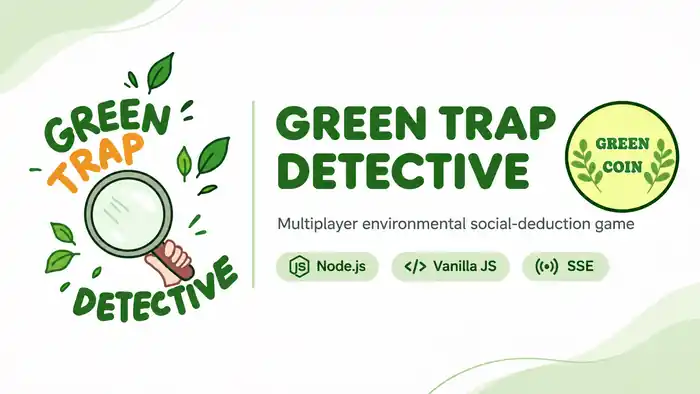

  

   

  <a href="https://greentrap.vercel.app/"><strong>PLAY THE LIVE DEMO</strong></a>
  &nbsp; · &nbsp;
  <a href="https://github.com/ryankn07/ee/issues">Report an issue</a>
  &nbsp; · &nbsp;
  <a href="docs/ARCHITECTURE.md">Explore the architecture</a>

    

  
  
  
  

# GREEN TRAP DETECTIVE

**One green project. Many hidden motives.**

GREEN TRAP DETECTIVE is a Vietnamese-language, browser-based multiplayer social-deduction game about environmental projects. Players discuss a project, submit private decisions, and uncover the outcome together — while trying to work out who is protecting the environment and who is sabotaging it.

The project combines a custom card-based game experience with a server-authoritative Node.js backend, real-time updates, private player-state projections, and a lightweight browser client.

## Brand identity

The project banner brings together the team’s **Green Trap** logo and the game’s **Green Coin** identity. Original project and role cards remain in `ui/cards/`.

## At a glance

| 25 original project cards | 10-round match | Live multiplayer | Server-authoritative rules |
|:---:|:---:|:---:|:---:|
| Original Canva artwork | Debate → action → reveal | HTTP + SSE | Private state stays server-side |

## The game, in pictures

The game uses an illustrated card system. These are original project assets already included in the repository — not stock images or mockups.

  <table>
    <tr>
      <td align="center" width="33%">
        
         <strong>Lá Phổi Xanh</strong>
         Environmental project
      </td>
      <td align="center" width="33%">
        
         <strong>Rừng Ngập Mặn Ven Biển</strong>
         Environmental restoration
      </td>
      <td align="center" width="33%">
        
         <strong>Băng Chuyền Phân Loại Rác</strong>
         AI-assisted recycling
      </td>
    </tr>
  </table>

### Different roles. Different information.

  <table>
    <tr>
      <td align="center" width="50%">
        
         <strong>NGƯỜI BẢO VỆ</strong>
         Protect environmental projects.
      </td>
      <td align="center" width="50%">
        
         <strong>NGƯỜI PHÁ HOẠI</strong>
         Hide your motives and influence decisions.
      </td>
    </tr>
  </table>

## How a match works

1. **Debate** — players submit public statements about the current project.
2. **Blind action** — players privately lock an investment decision and an optional bank action.
3. **Reveal** — the round outcome and project verdict become public.
4. **Next round** — the match continues until the game reaches its final state.

The server owns the phase clock, deadlines, validation, and transitions. The browser renders the state it receives; it does not decide the outcome.

## Architecture

| Component | Responsibility |
| --- | --- |
| Browser client | Session handling, responsive UI, card presentation, and player interactions |
| HTTP + SSE | Authenticated API requests, input validation, rate limits, and live snapshots |
| Room manager | Room lifecycle, player sessions, deadlines, and host permissions |
| Game engine | Game setup, rules, action validation, round resolution, and win conditions |
| Player projection | Sends each authenticated player only the private information they are allowed to see |
| File room store | Validates and atomically replaces room snapshots |

**Security principle:** hiding private information in the UI is not enough. The server builds a viewer-specific projection before state is sent over HTTP or SSE.

Read [the architecture guide](docs/ARCHITECTURE.md) for module responsibilities, trust boundaries, persistence, and deployment limitations.

## Technology

  
  
  
  
  
  

| Layer | Implementation |
| --- | --- |
| Runtime | Node.js 20+ |
| HTTP server | Node.js built-in HTTP module |
| Frontend | Vanilla JavaScript, HTML, and CSS |
| Realtime | Server-sent events (SSE) |
| Game logic | JavaScript modules in `engine/dist/` |
| Persistence | Validated JSON snapshots on the local filesystem |
| Static frontend | Vercel build output in `.web-dist/` |
| Automated tests | Node.js built-in test runner |
| CI | GitHub Actions on Node.js 20 and 22 |

The production runtime currently has **no third-party npm dependencies**.

## Run locally

### Requirements

- Node.js 20 or later
- Git

### Start the application

~~~bash
git clone https://github.com/ryankn07/ee.git
cd ee
npm ci
npm start
~~~

Open [http://localhost:3000](http://localhost:3000).

The default local setup does not require an environment file. The start lifecycle checks the compatibility bundle and restores only missing runtime files.

## Quality checks

Run these before submitting a change:

~~~bash
npm run check
npm test
npm run bundle:check
npm run build:web
~~~

| Check | What it covers |
| --- | --- |
| `npm run check` | JavaScript syntax, project catalog, Canva manifest, and required assets |
| `npm test` | Unit, integration, HTTP security, persistence, and regression tests |
| `npm run bundle:check` | Runtime compatibility bundle parity |
| `npm run build:web` | Static frontend build |

GitHub Actions runs the repository checks on **Node.js 20 and 22** for pushes and pull requests targeting `main`.

The optional Playwright browser suite requires an existing Playwright installation via `PLAYWRIGHT_MODULE_PATH`. If it is unavailable, browser tests are skipped and are not counted as executed coverage.

## Repository structure

~~~text
.
├── .github/              # CI, issue templates, PR template, Dependabot
├── docs/
│   ├── assets/           # Brand banner and architecture diagrams
│   ├── decisions/        # Architecture decision records
│   ├── ARCHITECTURE.md
│   ├── DEVELOPMENT.md
│   └── AI_ASSISTED_DEVELOPMENT.md
├── engine/dist/          # Game rules, setup, validation, player projection
├── public/               # Browser application runtime
├── scripts/              # Checks, build, asset import, bundle utilities
├── server/               # HTTP API, rooms, authentication, SSE, persistence
├── test/                 # Automated test suite
├── ui/
│   ├── brand/            # Brand assets
│   ├── cards/            # Original card artwork
│   ├── cards-hd/         # High-resolution card artwork
│   └── fonts/            # Local font assets and licenses
├── CONTRIBUTING.md
├── SECURITY.md
├── AGENTS.md
└── README.md
~~~

## Engineering decisions and operational limits

This project intentionally keeps its current lightweight runtime and documents its trade-offs.

- **Dependency-free runtime:** fewer runtime dependencies and a smaller supply-chain surface.
- **Server-authoritative gameplay:** private game information is filtered before it reaches a player.
- **Single-process persistence:** the current local file store and in-memory room state are not a distributed multi-instance architecture.
- **Compatibility bundle:** retained for the existing recovery path and checked for source parity.

The current file-based persistence model requires a persistent filesystem for recovery across restarts. Multiple server replicas do not share room state, SSE subscriptions, or in-memory rate limits. These are documented constraints, not claims of horizontal scalability or DDoS protection.

See [SCALE_AND_SECURITY.md](docs/SCALE_AND_SECURITY.md) for the recorded implementation notes and test evidence.

## Documentation

| Guide | Description |
| --- | --- |
| [Architecture](docs/ARCHITECTURE.md) | Components, data flow, trust boundaries, and scaling model |
| [Development](docs/DEVELOPMENT.md) | Setup, configuration, commands, and local workflow |
| [Architecture decisions](docs/decisions/) | Technical choices and trade-offs |
| [Contributing](CONTRIBUTING.md) | Branches, commits, review, and pull requests |
| [Security](SECURITY.md) | Security policy and vulnerability reporting |
| [AI-assisted development](docs/AI_ASSISTED_DEVELOPMENT.md) | Transparent use of AI tools and review principles |

## AI-assisted development

AI tools may assist with exploration, implementation suggestions, documentation, and test ideas. AI-generated changes are not treated as automatically correct: source code, tests, explicit requirements, and verified runtime behavior remain the sources of truth.

See [AI-assisted development](docs/AI_ASSISTED_DEVELOPMENT.md) for the project's review principles and an accurate portfolio disclosure.

## License

No open-source license is currently included. Public visibility does not by itself grant permission to reuse, modify, or redistribute this project.

---

  GREEN TRAP DETECTIVE · A project about green ideas, hidden motives, and better decisions.

