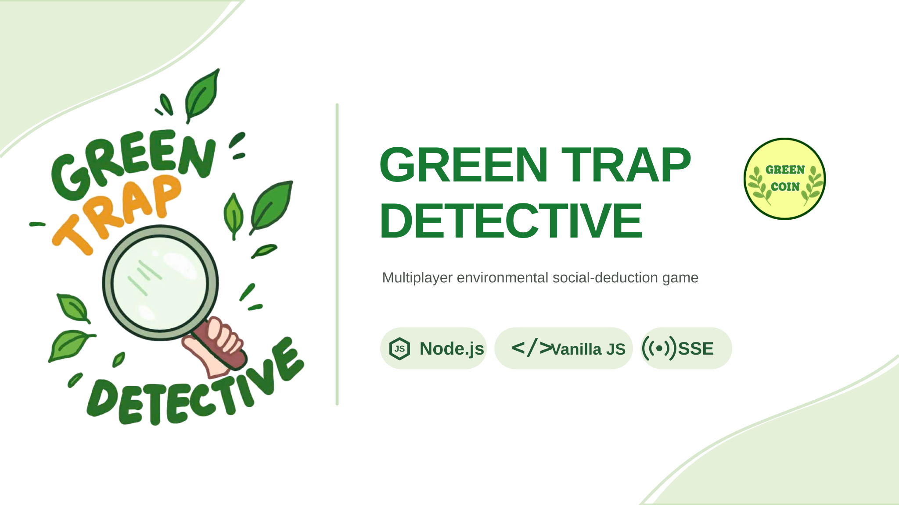
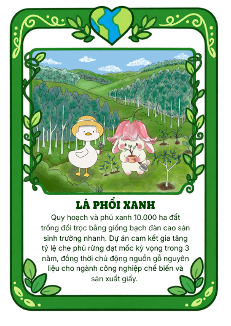
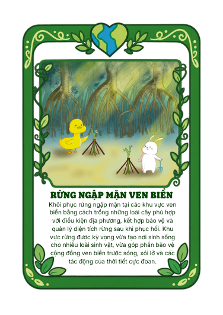
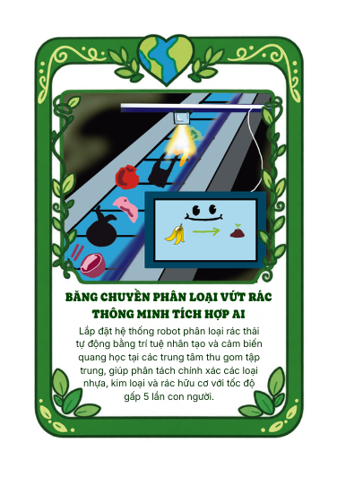
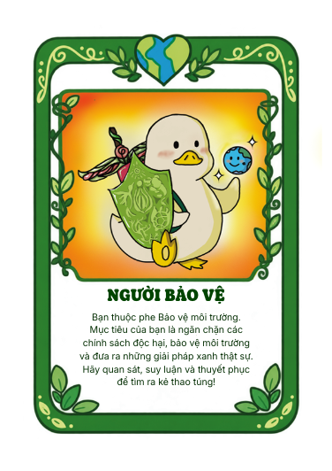
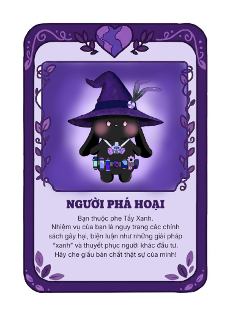
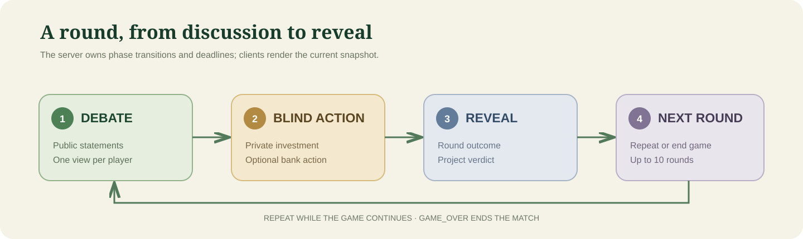
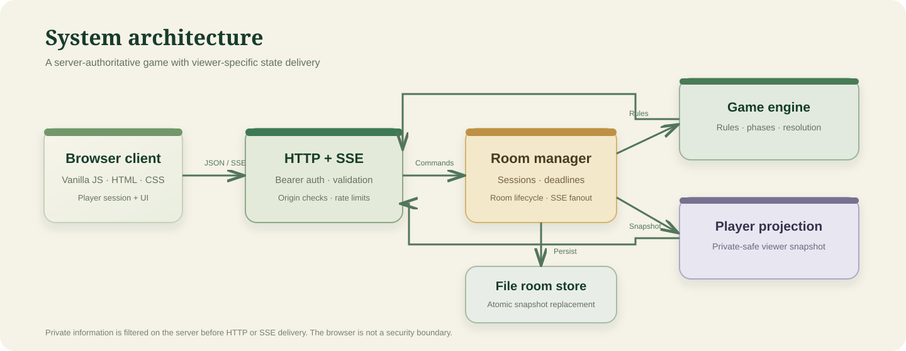

  

   

  <a href="https://greentrap.vercel.app/"><strong>CHƠI NGAY</strong></a>
  &nbsp; · &nbsp;
  <a href="https://github.com/ryankn07/ee/issues">Báo lỗi</a>
  &nbsp; · &nbsp;
  <a href="docs/ARCHITECTURE.md">Tìm hiểu kiến trúc</a>
  &nbsp; · &nbsp;
  <a href="docs/README.md">Tài liệu</a>

    

  <a href="#tieng-viet">Tiếng Việt</a>
  &nbsp; · &nbsp;
  <a href="#english">English</a>

    

  
  
  
  

# GREEN TRAP DETECTIVE

## Tiếng Việt

**Một dự án xanh. Nhiều động cơ ẩn giấu.**

GREEN TRAP DETECTIVE là trò chơi suy luận xã hội nhiều người chơi trên trình duyệt, sử dụng tiếng Việt và xoay quanh các dự án môi trường. Người chơi cùng thảo luận về một dự án, đưa ra quyết định riêng tư và khám phá kết quả — đồng thời tìm hiểu ai đang bảo vệ môi trường và ai đang âm thầm phá hoại dự án.

Dự án kết hợp trải nghiệm chơi dựa trên thẻ bài do nhóm tự xây dựng với máy chủ Node.js chịu trách nhiệm điều phối luật chơi, cập nhật theo thời gian thực, phân quyền dữ liệu riêng cho từng người chơi và giao diện trình duyệt gọn nhẹ.

### Nhận diện thương hiệu

Biểu ngữ dự án kết hợp biểu trưng **Green Trap** của nhóm với hình ảnh **Green Coin** trong trò chơi. Các thẻ dự án và thẻ vai trò do nhóm tự thiết kế được lưu trong thư mục `ui/cards/`.

### Tổng quan nhanh

| 25 thẻ dự án nguyên bản | Trận đấu 10 vòng | Nhiều người chơi trực tuyến | Luật chơi do máy chủ quyết định |
|:---:|:---:|:---:|:---:|
| Minh họa do nhóm thực hiện trên Canva | Thảo luận → hành động → công bố | HTTP + SSE | Dữ liệu riêng tư được giữ ở phía máy chủ |

### Hình ảnh trong trò chơi

Trò chơi sử dụng hệ thống thẻ minh họa riêng. Đây là các tài nguyên hình ảnh gốc đã được đưa vào kho mã nguồn, không phải ảnh mẫu hay hình minh họa tạm thời.

  <table>
    <tr>
      <td align="center" width="33%">
        
         <strong>Lá Phổi Xanh</strong>
         Dự án môi trường
      </td>
      <td align="center" width="33%">
        
         <strong>Rừng Ngập Mặn Ven Biển</strong>
         Phục hồi hệ sinh thái
      </td>
      <td align="center" width="33%">
        
         <strong>Băng Chuyền Phân Loại Rác</strong>
         Tái chế có hỗ trợ AI
      </td>
    </tr>
  </table>

#### Khác vai trò. Khác thông tin.

  <table>
    <tr>
      <td align="center" width="50%">
        
         <strong>NGƯỜI BẢO VỆ</strong>
         Bảo vệ các dự án môi trường.
      </td>
      <td align="center" width="50%">
        
         <strong>NGƯỜI PHÁ HOẠI</strong>
         Che giấu động cơ và tác động đến quyết định.
      </td>
    </tr>
  </table>

### Một ván chơi diễn ra như thế nào?

1. **Thảo luận** — người chơi gửi nhận định công khai về dự án hiện tại.
2. **Hành động bí mật** — mỗi người chơi khóa quyết định đầu tư và có thể thực hiện thêm một hành động ngân hàng.
3. **Công bố** — kết quả của vòng chơi và đánh giá dự án được công khai.
4. **Vòng tiếp theo** — trận đấu tiếp tục cho đến khi đạt trạng thái kết thúc.

Máy chủ quản lý đồng hồ của từng giai đoạn, thời hạn, việc kiểm tra dữ liệu đầu vào và quá trình chuyển trạng thái. Trình duyệt chỉ hiển thị trạng thái nhận được, không tự quyết định kết quả trò chơi.

### Kiến trúc hệ thống

| Thành phần | Nhiệm vụ |
| --- | --- |
| Giao diện trình duyệt | Quản lý phiên, giao diện thích ứng, hiển thị thẻ và tương tác của người chơi |
| HTTP + SSE | Xử lý yêu cầu API có xác thực, kiểm tra dữ liệu đầu vào, giới hạn tần suất và gửi trạng thái trực tiếp |
| Bộ quản lý phòng | Quản lý vòng đời phòng, phiên người chơi, thời hạn và quyền của chủ phòng |
| Bộ máy trò chơi | Khởi tạo ván chơi, áp dụng luật, kiểm tra hành động, xử lý vòng và điều kiện chiến thắng |
| Lớp phân tách dữ liệu người chơi | Chỉ gửi cho mỗi người chơi những thông tin riêng tư mà họ được phép xem |
| Kho lưu phòng | Kiểm tra dữ liệu và thay thế ảnh chụp trạng thái phòng theo cách nguyên tử |

**Nguyên tắc bảo mật:** chỉ ẩn thông tin riêng tư trên giao diện là chưa đủ. Máy chủ phải tạo một bản dữ liệu riêng theo từng người xem trước khi gửi trạng thái qua HTTP hoặc SSE.

Đọc [tài liệu kiến trúc](docs/ARCHITECTURE.md) để tìm hiểu trách nhiệm của từng mô-đun, ranh giới tin cậy, cơ chế lưu trữ và các giới hạn khi triển khai.

### Công nghệ sử dụng

  
  
  
  
  
  

| Lớp | Công nghệ triển khai |
| --- | --- |
| Môi trường chạy | Node.js 20+ |
| Máy chủ HTTP | Mô-đun HTTP tích hợp sẵn của Node.js |
| Giao diện | JavaScript thuần, HTML và CSS |
| Cập nhật thời gian thực | Server-Sent Events (SSE) |
| Luật trò chơi | Các mô-đun JavaScript trong `engine/dist/` |
| Lưu trữ | Ảnh chụp trạng thái JSON đã được kiểm tra trên hệ thống tệp cục bộ |
| Giao diện tĩnh | Sản phẩm dựng cho Vercel trong `.web-dist/` |
| Kiểm thử tự động | Bộ kiểm thử tích hợp sẵn của Node.js |
| Tích hợp liên tục | GitHub Actions trên Node.js 20 và 22 |

Môi trường chạy chính thức hiện **không sử dụng thư viện npm của bên thứ ba**.

### Chạy dự án trên máy cá nhân

#### Yêu cầu

- Node.js phiên bản 20 trở lên
- Git

#### Khởi động ứng dụng

~~~bash
git clone https://github.com/ryankn07/ee.git
cd ee
npm ci
npm start
~~~

Mở [http://localhost:3000](http://localhost:3000).

Cấu hình chạy cục bộ mặc định không yêu cầu tệp môi trường. Quy trình khởi động sẽ kiểm tra gói tương thích và chỉ khôi phục những tệp chạy còn thiếu.

### Kiểm tra chất lượng

Chạy các lệnh sau trước khi gửi thay đổi:

~~~bash
npm run check
npm test
npm run bundle:check
npm run build:web
~~~

| Lệnh kiểm tra | Nội dung |
| --- | --- |
| `npm run check` | Cú pháp JavaScript, danh mục dự án, tệp kê khai Canva và các tài nguyên bắt buộc |
| `npm test` | Kiểm thử đơn vị, tích hợp, bảo mật HTTP, lưu trữ và hồi quy |
| `npm run bundle:check` | Đối chiếu tính tương thích của gói chạy |
| `npm run build:web` | Dựng giao diện tĩnh |

GitHub Actions tự động chạy các bước kiểm tra trên **Node.js 20 và 22** khi có thay đổi được đẩy lên hoặc tạo yêu cầu hợp nhất nhắm đến nhánh `main`.

Bộ kiểm thử trình duyệt Playwright là tùy chọn và yêu cầu đã cài Playwright thông qua `PLAYWRIGHT_MODULE_PATH`. Nếu không có, các bài kiểm thử trình duyệt sẽ được bỏ qua và không được tính là phạm vi kiểm thử đã thực thi.

### Cấu trúc kho mã nguồn

~~~text
.
├── .github/              # CI, mẫu issue, mẫu pull request, Dependabot
├── docs/
│   ├── assets/           # Biểu ngữ thương hiệu và sơ đồ kiến trúc
│   ├── decisions/        # Hồ sơ quyết định kiến trúc
│   ├── README.md           # Documentation index
│   ├── ARCHITECTURE.md
│   ├── DEVELOPMENT.md
│   ├── SCALE_AND_SECURITY.md
│   ├── GLOSSARY.md
│   └── AI_ASSISTED_DEVELOPMENT.md
├── engine/dist/          # Luật chơi, khởi tạo, kiểm tra và phân tách dữ liệu người chơi
├── public/               # Mã chạy ứng dụng trên trình duyệt
├── runtime/
│   └── compatibility/    # Generated runtime recovery bundle
├── scripts/              # Công cụ kiểm tra, dựng ứng dụng, nhập tài nguyên và tạo gói
├── server/               # API HTTP, phòng chơi, xác thực, SSE và lưu trữ
├── test/                 # Bộ kiểm thử tự động
├── ui/
│   ├── brand/            # Tài nguyên thương hiệu
│   ├── cards/            # Hình minh họa thẻ gốc
│   ├── cards-hd/         # Hình minh họa thẻ độ phân giải cao
│   └── fonts/            # Phông chữ cục bộ và giấy phép
├── CONTRIBUTING.md
├── SECURITY.md
├── AGENTS.md
└── README.md
~~~

### Quyết định kỹ thuật và giới hạn vận hành

Dự án chủ động duy trì môi trường chạy gọn nhẹ hiện tại và công khai những đánh đổi đi kèm.

- **Không phụ thuộc thư viện bên thứ ba khi chạy:** giảm số lượng thư viện cần có và thu hẹp bề mặt rủi ro từ chuỗi cung ứng phần mềm.
- **Máy chủ quyết định kết quả trò chơi:** thông tin riêng tư được lọc trước khi gửi đến người chơi.
- **Lưu trữ trong một tiến trình:** kho tệp cục bộ và trạng thái phòng trong bộ nhớ hiện tại không phải kiến trúc nhiều máy chủ phân tán.
- **Gói tương thích:** được giữ lại cho cơ chế khôi phục hiện có và được kiểm tra tính đồng nhất với mã nguồn.

Mô hình lưu trữ bằng tệp hiện tại cần một hệ thống tệp có khả năng lưu dữ liệu lâu dài để khôi phục sau khi khởi động lại. Nhiều bản sao máy chủ không dùng chung trạng thái phòng, đăng ký SSE hoặc giới hạn tần suất lưu trong bộ nhớ. Đây là những giới hạn đã được ghi nhận, không phải tuyên bố về khả năng mở rộng theo chiều ngang hay khả năng chống tấn công từ chối dịch vụ phân tán (DDoS).

Xem [SCALE_AND_SECURITY.md](docs/SCALE_AND_SECURITY.md) để biết ghi chú triển khai và bằng chứng kiểm thử đã được ghi nhận.

### Tài liệu

| Tài liệu | Nội dung |
| --- | --- |
| [Mục lục tài liệu](docs/README.md) | Điểm bắt đầu để tìm toàn bộ hướng dẫn và hồ sơ kỹ thuật |
| [Kiến trúc](docs/ARCHITECTURE.md) | Thành phần, luồng dữ liệu, ranh giới tin cậy và mô hình mở rộng |
| [Mở rộng và bảo mật](docs/SCALE_AND_SECURITY.md) | Biện pháp bảo vệ, phép đo tải cục bộ và giới hạn vận hành |
| [Phát triển](docs/DEVELOPMENT.md) | Cài đặt, cấu hình, câu lệnh và quy trình làm việc cục bộ |
| [Thuật ngữ](docs/GLOSSARY.md) | Bảng thuật ngữ tiếng Việt |
| [Các quyết định kiến trúc](docs/decisions/) | Lựa chọn kỹ thuật và những đánh đổi |
| [Đóng góp cho dự án](CONTRIBUTING.md) | Nhánh, commit, đánh giá thay đổi và pull request |
| [Bảo mật](SECURITY.md) | Chính sách bảo mật và cách báo cáo lỗ hổng |
| [Phát triển có hỗ trợ AI](docs/AI_ASSISTED_DEVELOPMENT.md) | Công khai việc sử dụng công cụ AI và nguyên tắc đánh giá |

### Phát triển có hỗ trợ AI

Các công cụ AI có thể hỗ trợ tìm hiểu mã nguồn, đề xuất cách triển khai, viết tài liệu và đưa ra ý tưởng kiểm thử. Tuy nhiên, thay đổi do AI tạo ra không mặc nhiên được xem là chính xác: mã nguồn, kết quả kiểm thử, yêu cầu cụ thể và hành vi thực tế đã xác minh vẫn là căn cứ đáng tin cậy nhất.

Xem [tài liệu phát triển có hỗ trợ AI](docs/AI_ASSISTED_DEVELOPMENT.md) để biết nguyên tắc đánh giá và nội dung công khai chính xác về việc sử dụng AI trong dự án.

### Giấy phép

Hiện tại, dự án chưa có giấy phép mã nguồn mở. Việc kho mã nguồn được công khai không đồng nghĩa với việc người khác được tự do sử dụng lại, chỉnh sửa hoặc phân phối dự án.

---

  GREEN TRAP DETECTIVE · Một dự án về ý tưởng xanh, động cơ ẩn giấu và những quyết định sáng suốt hơn.

<strong>English version</strong>

# GREEN TRAP DETECTIVE

**One green project. Many hidden motives.**

GREEN TRAP DETECTIVE is a Vietnamese-language, browser-based multiplayer social-deduction game about environmental projects. Players discuss a project, submit private decisions, and uncover the outcome together — while trying to work out who is protecting the environment and who is sabotaging it.

The project combines a custom card-based game experience with a server-authoritative Node.js backend, real-time updates, private player-state projections, and a lightweight browser client.

## Brand identity

The project banner brings together the team’s **Green Trap** logo and the game’s **Green Coin** identity. Original project and role cards remain in `ui/cards/`.

## At a glance

| 25 original project cards | 10-round match | Live multiplayer | Server-authoritative rules |
|:---:|:---:|:---:|:---:|
| Original Canva artwork | Debate → action → reveal | HTTP + SSE | Private state stays server-side |

## The game, in pictures

The game uses an illustrated card system. These are original project assets already included in the repository — not stock images or mockups.

  <table>
    <tr>
      <td align="center" width="33%">
        
         <strong>Lá Phổi Xanh</strong>
         Environmental project
      </td>
      <td align="center" width="33%">
        
         <strong>Rừng Ngập Mặn Ven Biển</strong>
         Environmental restoration
      </td>
      <td align="center" width="33%">
        
         <strong>Băng Chuyền Phân Loại Rác</strong>
         AI-assisted recycling
      </td>
    </tr>
  </table>

### Different roles. Different information.

  <table>
    <tr>
      <td align="center" width="50%">
        
         <strong>NGƯỜI BẢO VỆ</strong>
         Protect environmental projects.
      </td>
      <td align="center" width="50%">
        
         <strong>NGƯỜI PHÁ HOẠI</strong>
         Hide your motives and influence decisions.
      </td>
    </tr>
  </table>

## How a match works

1. **Debate** — players submit public statements about the current project.
2. **Blind action** — players privately lock an investment decision and an optional bank action.
3. **Reveal** — the round outcome and project verdict become public.
4. **Next round** — the match continues until the game reaches its final state.

The server owns the phase clock, deadlines, validation, and transitions. The browser renders the state it receives; it does not decide the outcome.

## Architecture

| Component | Responsibility |
| --- | --- |
| Browser client | Session handling, responsive UI, card presentation, and player interactions |
| HTTP + SSE | Authenticated API requests, input validation, rate limits, and live snapshots |
| Room manager | Room lifecycle, player sessions, deadlines, and host permissions |
| Game engine | Game setup, rules, action validation, round resolution, and win conditions |
| Player projection | Sends each authenticated player only the private information they are allowed to see |
| File room store | Validates and atomically replaces room snapshots |

**Security principle:** hiding private information in the UI is not enough. The server builds a viewer-specific projection before state is sent over HTTP or SSE.

Read [the architecture guide](docs/ARCHITECTURE.md) for module responsibilities, trust boundaries, persistence, and deployment limitations.

## Technology

  
  
  
  
  
  

| Layer | Implementation |
| --- | --- |
| Runtime | Node.js 20+ |
| HTTP server | Node.js built-in HTTP module |
| Frontend | Vanilla JavaScript, HTML, and CSS |
| Realtime | Server-sent events (SSE) |
| Game logic | JavaScript modules in `engine/dist/` |
| Persistence | Validated JSON snapshots on the local filesystem |
| Static frontend | Vercel build output in `.web-dist/` |
| Automated tests | Node.js built-in test runner |
| CI | GitHub Actions on Node.js 20 and 22 |

The production runtime currently has **no third-party npm dependencies**.

## Run locally

### Requirements

- Node.js 20 or later
- Git

### Start the application

~~~bash
git clone https://github.com/ryankn07/ee.git
cd ee
npm ci
npm start
~~~

Open [http://localhost:3000](http://localhost:3000).

The default local setup does not require an environment file. The start lifecycle checks the compatibility bundle and restores only missing runtime files.

## Quality checks

Run these before submitting a change:

~~~bash
npm run check
npm test
npm run bundle:check
npm run build:web
~~~

| Check | What it covers |
| --- | --- |
| `npm run check` | JavaScript syntax, project catalog, Canva manifest, and required assets |
| `npm test` | Unit, integration, HTTP security, persistence, and regression tests |
| `npm run bundle:check` | Runtime compatibility bundle parity |
| `npm run build:web` | Static frontend build |

GitHub Actions runs the repository checks on **Node.js 20 and 22** for pushes and pull requests targeting `main`.

The optional Playwright browser suite requires an existing Playwright installation via `PLAYWRIGHT_MODULE_PATH`. If it is unavailable, browser tests are skipped and are not counted as executed coverage.

## Repository structure

~~~text
.
├── .github/              # CI, issue templates, PR template, Dependabot
├── docs/
│   ├── assets/           # Brand banner and architecture diagrams
│   ├── decisions/        # Architecture decision records
│   ├── ARCHITECTURE.md
│   ├── DEVELOPMENT.md
│   ├── GLOSSARY.md
│   └── AI_ASSISTED_DEVELOPMENT.md
├── engine/dist/          # Game rules, setup, validation, player projection
├── public/               # Browser application runtime
├── runtime/
│   └── compatibility/    # Generated runtime recovery bundle
├── scripts/              # Checks, build, asset import, bundle utilities
├── server/               # HTTP API, rooms, authentication, SSE, persistence
├── test/                 # Automated test suite
├── ui/
│   ├── brand/            # Brand assets
│   ├── cards/            # Original card artwork
│   ├── cards-hd/         # High-resolution card artwork
│   └── fonts/            # Local font assets and licenses
├── CONTRIBUTING.md
├── SECURITY.md
├── AGENTS.md
└── README.md
~~~

## Engineering decisions and operational limits

This project intentionally keeps its current lightweight runtime and documents its trade-offs.

- **Dependency-free runtime:** fewer runtime dependencies and a smaller supply-chain surface.
- **Server-authoritative gameplay:** private game information is filtered before it reaches a player.
- **Single-process persistence:** the current local file store and in-memory room state are not a distributed multi-instance architecture.
- **Compatibility bundle:** retained for the existing recovery path and checked for source parity.

The current file-based persistence model requires a persistent filesystem for recovery across restarts. Multiple server replicas do not share room state, SSE subscriptions, or in-memory rate limits. These are documented constraints, not claims of horizontal scalability or DDoS protection.

See [SCALE_AND_SECURITY.md](docs/SCALE_AND_SECURITY.md) for the recorded implementation notes and test evidence.

## Documentation

| Guide | Description |
| --- | --- |
| [Documentation index](docs/README.md) | Entry point for all guides and engineering records |
| [Architecture](docs/ARCHITECTURE.md) | Components, data flow, trust boundaries, and scaling model |
| [Scale and security](docs/SCALE_AND_SECURITY.md) | Security controls, local load measurements, and operational limits |
| [Development](docs/DEVELOPMENT.md) | Setup, configuration, commands, and local workflow |
| [Glossary](docs/GLOSSARY.md) | Vietnamese game terminology |
| [Architecture decisions](docs/decisions/) | Technical choices and trade-offs |
| [Contributing](CONTRIBUTING.md) | Branches, commits, review, and pull requests |
| [Security](SECURITY.md) | Security policy and vulnerability reporting |
| [AI-assisted development](docs/AI_ASSISTED_DEVELOPMENT.md) | Transparent use of AI tools and review principles |

## AI-assisted development

AI tools may assist with exploration, implementation suggestions, documentation, and test ideas. AI-generated changes are not treated as automatically correct: source code, tests, explicit requirements, and verified runtime behavior remain the sources of truth.

See [AI-assisted development](docs/AI_ASSISTED_DEVELOPMENT.md) for the project's review principles and an accurate portfolio disclosure.

## License

No open-source license is currently included. Public visibility does not by itself grant permission to reuse, modify, or redistribute this project.

---

  GREEN TRAP DETECTIVE · A project about green ideas, hidden motives, and better decisions.

