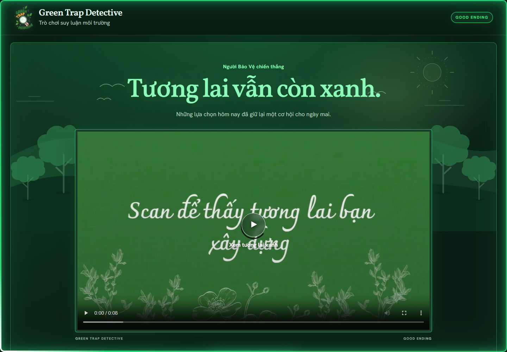
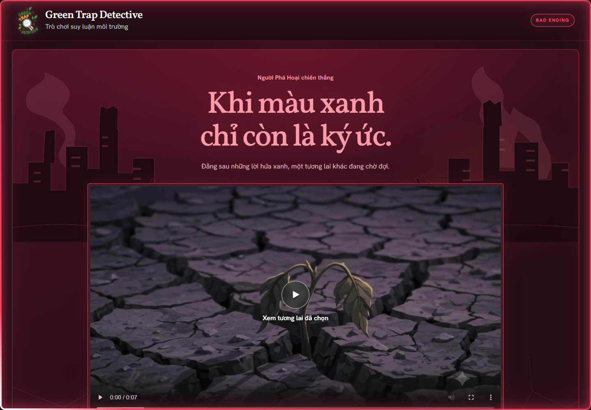
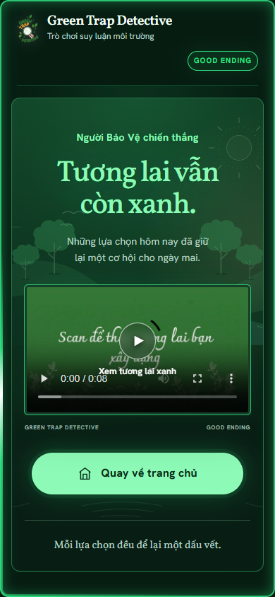

# Video endings — 2 November 2026

## Current team decision — 3 November 2026

**Nhóm đã thống nhất không dùng mã QR hoặc luồng quét mã nữa; chiếu video trực tiếp trên màn ending. Không thêm lại mã QR, hướng dẫn quét, camera hay cột quét thẻ.** Video uses the full content width previously shared with the scan sidebar. This owner-approved team decision supersedes the original scanning proposal in `GREEN IMPACT PLAN.md` rule 11 and any earlier notes or screenshots. Future Codex changes must retain this behavior unless the owner explicitly revises the decision.

The owner supplied `good end.mp4` and `bad end.mp4` and requested an ending screen with additional effects. The supplied footage and original card artwork remain unchanged.

## Implemented behavior

- The authenticated snapshot's `game.outcome.winner` chooses the film: `PROTECTOR` → Good Ending; `SABOTEUR` → Bad Ending. This is shared by every player, including players on the losing faction. Approval totals do not independently override the engine's winner.
- A draw stays neutral and does not select either film. The plan supplies no draw film or tie-specific narrative.
- After game over, the page shows the real outcome, approval totals, full last-round reveal, history and now-public roles. A player explicitly starts the film; it does not autoplay with sound.
- The selected film plays directly on the result screen. There is no scan sidebar, QR generator, scan instruction or “Dấu vết của ván chơi / Những lá thẻ cùng tương lai” card gallery. The final-round result, journal and public roles remain below the film. Original card PNG pixels are unchanged; existing standalone viewer URLs continue to work.
- `TRUTH` verdict labels are green in round reveals, the final-round result and journals, independently of the winning faction or ending theme. Bad Ending retains its red atmosphere while individual Truth labels stay green.
- A game ending before a matching project is resolved still shows the correct winner's film. No played project is fabricated.
- All 25 catalog records now have an `endingVideoUrl` corresponding to their own alignment. These fields are not added to the private pre-reveal player projection.
- Further presence snapshots update the final roster without replacing the video element or resetting playback.
- Ordinary eliminated players have a horizontal strike through their name only. At game over, successful expulsion names every player whose eligible contribution formed that target's pool; bankruptcy says **Bị loại do hết xu**, and host removal names the host while retaining its separate pencil effect. Contributors are recorded in private engine state and become public only in the terminal player projection. No contribution amounts are revealed. Existing results without recorded contributor IDs say **Đã bị trục xuất**, without guessing an actor.
- The two-second vote-out effect belongs to the in-match player tile, not this ending roster. A final vote briefly presents its effect on the inert board before the ending chapter; the accepted final snapshot is already cached and the room retired. See [in-match elimination motion](ELIMINATION_EFFECT.md).

The standalone viewer deliberately needs no room credentials. Its ordinary link contains an ending key and, when available, a public card ID; it never contains a room code or bearer token. The main result screen does not require opening that viewer to watch its film.

## Media and delivery

The two MP4 files in `ui/endings/` are byte-for-byte copies of the owner's supplied videos, with portable filenames. Both are H.264, 3840 × 2160: Good Ending is approximately 8.03 seconds, Bad Ending 7.23 seconds. The JPEG posters are frames extracted from those videos; no generated illustration replaces the supplied footage.

`server/ending-media.cjs` exposes only those two filenames and their posters. It streams files and implements single byte ranges, suffix ranges, HEAD and 416 responses, so playback and seeking do not require buffering whole films in server memory. `scripts/build-web.cjs` also copies the videos, posters and viewer into the Vercel static output.

The unused QR generator, public script route and build output have been removed. No QR service or camera permission is involved in video playback.

## Presentation and boundaries

The owner's later design refinement uses a deep emerald surface for Good Ending and a crimson surface for Bad Ending. A matching fixed glow outlines the browser viewport, with a slow light traveling around the edge. The overlay ignores pointer input. Reduced-motion preference stops the traveling light and decorative animation while retaining the static colored edge.

The separate “Mở video riêng” link has been removed. The highlighted “Quay về trang chủ” control is centered directly below the full-width film, before the detailed game records; the standalone viewer uses the same treatment. The home, lobby, active phases, artwork and gameplay rules are retained. No winner-rule or phase-timer change is part of this work.

The ending label now appears in the shared masthead. Logo sizing, title capitalization, type spacing and desktop bar height match the home page; the duplicate brand/ending row inside the standalone viewer was removed. Bad Ending uses decorative broken buildings, smokestacks, bare trees and cracked ground instead of the botanical backdrop. These SVG elements are aria-hidden, remain behind the content and do not capture pointer input.

The viewer and in-game result now share the same fluid outer gutters and stage. Desktop video width is proportional to the stage, with an additional viewport-height bound, instead of stopping at 980 px while the surrounding stage keeps growing. Heading sizes also account for available height. The video retains its native 16:9 ratio with `object-fit: contain`; the page scrolls naturally when its full content exceeds the window. The masthead still uses the home page's sizing.

Ending scroll fix — 3 November 2026: `GAME_OVER` now exits the active-game layout class before rendering the result. This releases the PC board's fixed viewport height and `overflow:hidden`, which previously clipped the ending and blocked page scrolling. Wheel/keyboard checks cover both faction endings and draws, expanded result details, refresh from the cached final snapshot, and standalone card viewers on desktop and phones. Active phases retain their existing compact board layout.

Removed-player rows use the ending's own dark surface and accent-colored pencil marks. The identity stays dimmed, the marks remain contained in the tile, and the settled effect does not replay on refresh or later snapshots. Ordinary elimination is still distinct from host removal.

Good Ending uses those same responsive proportions and adds a dedicated recovering landscape: tree canopies, layered green hills, a winding river, sun rays, birds and foreground meadow/ripples. The brief sunlight and bird entrance animations settle within five seconds and stop under reduced motion. These elements are decorative SVG/CSS behind the copy; original cards and supplied footage remain unchanged. Draws keep their neutral backdrop.

Each tree now groups its crown, trunk, branches and root shadow under one local SVG transform. The forest corners have independent responsive sizes, rather than enlarging the trees with the entire 175%-wide mobile landscape. This keeps tree axes aligned and reduces the mobile decoration without changing the video proportions.

## Verification

- Added tests cover media byte accuracy/ranges, HEAD, malformed requests, exact public routes, winner-to-film mapping, draws, escaped project text, catalog links and private projection boundaries.
- The existing Playwright tests ran using the installed Chrome browser and bundled Playwright module; they were not treated as skipped coverage.
- Separate browser QA covers good/bad/draw, responsive film proportions, selected-film playback, seeking, standalone links, presence-update playback preservation, removed-player marks, page scrolling and reduced motion. Regression checks enforce the absence of QR markup, requests and build assets.
- Syntax, runtime bundle parity, full tests and static build were checked. Screenshots and current command results are retained outside the checkout in the task's outputs directory.

This implementation is local. No commit, push, hosting configuration change or deployment is implied.

## Review screenshots

Standalone viewers, captured without room credentials or private player data:

