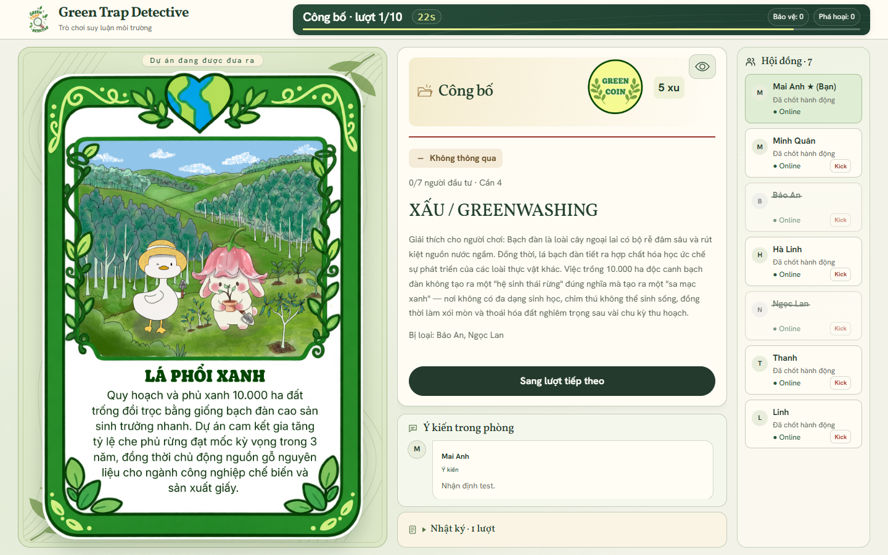
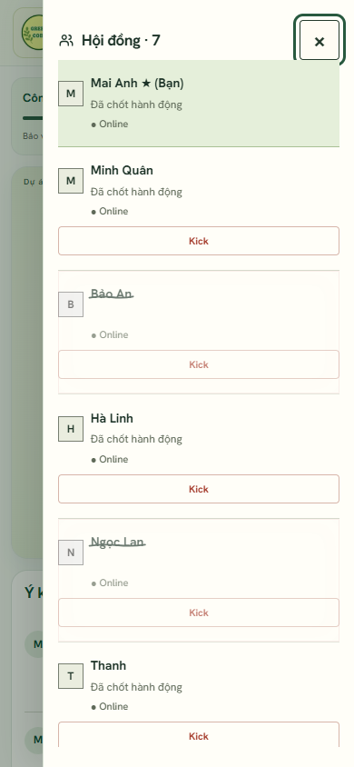
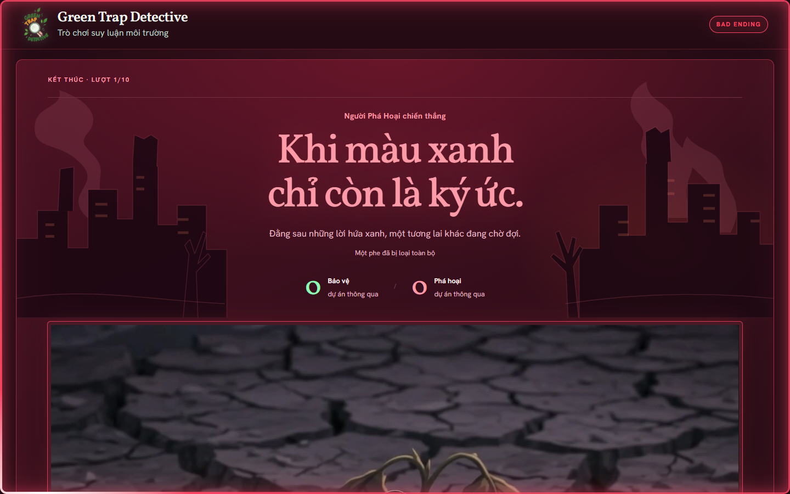

# Integration review — 3 November 2026

Verified against upstream main `340b8d2a8a6d15f7cd719d4085f2d6c7755b4062` (through PR #40). This record describes local verification before the review request; it is not a production deployment record.

## Combined behavior

- Retain upstream's compact desktop board, mobile components, new heading/board artwork, self highlight, history disclosure, inline wallet, editable-form expansion and confirmed-form collapse. Preserve its room-link correction, revision guard and panel scroll restoration.
- Keep the owner's two-second phase/project chapters and separate green/red ending chapters. Queue upstream card/reveal entrance motion until the chapter closes, including when a presence update cancels the first animation frame. The queued scene is discarded when room/game/round/phase changes.
- Play successful vote-out feedback on the live participant tile after the reveal chapter; use a static name strike and true attribution in final results. Contributor identities remain private during play. Host removal keeps its separate inline confirmation and pencil effect.
- Retire completed rooms immediately and release admission capacity. Retain only bounded, authenticated final results, close live transport and preserve the browser's final view/video on refresh.
- Show the supplied ending video directly across the content width. Keep QR flows and the former card gallery removed, keep Truth labels green, and allow ending pages to scroll on desktop and phones.
- Retain upstream's framed ending records using the ending theme's surface/border colors: a fixed cream background would make the inherited light text unreadable. Browser checks require at least 4.5:1 contrast for record summaries and result paragraphs.

## Verification actually run

- `node scripts/check.cjs`: passed (67 JavaScript files, 25 project records/card assets).
- `node scripts/restore-runtime-bundle.cjs --check`: passed (4 files, 25 records); generated bundle rebuilt from merged source.
- `node --test` with the bundled Playwright module and installed Chrome: **126 passed, 0 failed, 0 skipped** (43.3 seconds). Includes desktop/mobile layouts, active phases, vote/kick feedback, final-vote ordering, private projections, room retirement, SSE/polling, cached endings, scrolling, contrast and no-QR checks.
- `node scripts/build-web.cjs`: passed. Static delivery includes motion/media and excludes QR and local test tools.
- Isolated PostgreSQL-compatible SQL harness: passed legacy backfill, immediate quota release, receipt replay, stale-write rejection, expiry/purge and anonymous privilege checks.
- `git diff --check`: passed. Local test controls, temporary demo/QA tools, credentials and room snapshots are excluded from the change.

## Deployment prerequisite

**Apply `supabase/migrations/20261103_completed_results.sql` after the existing serverless migration and before deploying the updated serverless Function.** It creates the private final-result storage and updates the room RPCs. The isolated SQL checks do not substitute for applying it to hosted Supabase. No hosted database migration or production deployment was performed here.

## Review screenshots

Captured from the merged renderer using disposable local QA names. No room code, bearer token or production snapshot is included. The participant screenshots show the settled post-vote state; the browser tests also verify the timed in-match effect.

